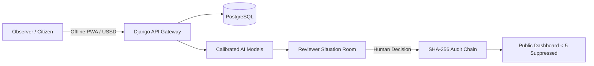

# ElectraGuard AI
> Nonpartisan election-observation and citizen-accountability system for Nigeria.  
> **Track:** #AI4Elections Track 5 (Election Observation and Citizen Accountability, integrating Tracks 1–4)  
> **Team:** Cairn (Team Lead: Kara Wari Sylva)  
> **Status:** Prototype

---

## Problem
During Nigerian elections across 176,846 polling units, field observers and citizens lack resilient, private tools to document irregularities under weak or nonexistent cellular connectivity. Central situation rooms face overwhelming backlogs of unstructured, multi-dialectal reports, duplicate filings, and viral social media rumours, while citizens who report incidents face safety risks and receive zero follow-up.

ElectraGuard AI addresses the following hackathon challenge problem IDs:
- **Track 5 (Primary):** 5A (Offline-first observer checklist & incident reporting), 5B (Automated incident triage & urgency prioritization), 5C (Evidence hygiene without exposing observer identity), 5D (Public access to plain-language guidance), 5E (Feedback loop with citizen receipt tracking).
- **Track 1:** 1A (Misinformation detection & rumour desk), 1B (Veracity & claim harm prioritization).
- **Track 2:** 2A (Spatial anomaly & incident cluster detection), 2C (Materials transit delay risk modeling).
- **Track 3:** 3A (Inclusive multi-dialectal support: English, Nigerian Pidgin, Hausa, Yorùbá, Igbo), 3B (Feature phone access via SMS and USSD `*384*24#`).
- **Track 4:** 4A (Zero-PII architecture & anonymous code/PIN auth), 4C (Verifiable SHA-256 Merkle-style audit chaining).

---

## What It Does (and Does NOT Do)

### What it DOES:
- **Offline-First Field Reporting:** Accredited observers record incidents, checklists, and result sheets with on-device encryption and automatic queued synchronization when network resumes.
- **Telecom Ingestion on Basic Phones:** Citizens report without internet via interactive USSD (`*384*24#`) and SMS, receiving instant cryptographic tracking receipts.
- **Calibrated Human-in-the-Loop Triage:** Statistical models suggest categories, rank urgency, detect duplicate reports, identify spatial clusters, and check result-sheet arithmetic.
- **Strict Privacy Safeguards:** Observer accounts use random batch codes and 6-digit PINs (no names, phones, or emails). Citizen phone numbers are converted to irreversible `HMAC-SHA256` hashes immediately upon receipt.
- **Privacy-Preserving Public Transparency:** Aggregated transparency dashboard suppresses any geographic cell with fewer than 5 reports (`< 5`) to prevent informant re-identification.

### What it DOES NOT Do:
- **Does NOT declare or project election results:** Official outcomes remain the sole constitutional prerogative of INEC.
- **Does NOT make autonomous decisions:** AI models propose suggestions only; all verifications, corroborations, and debunks require human authorization.
- **Does NOT profile or microtarget voters:** The platform is strictly nonpartisan with zero behavioral tracking or advertising tech.
- **Does NOT connect to live institutional systems:** Tested exclusively on synthetic and public reference data.

---

## Demo
- **Demonstration Video (3-minute walk-through):** [`docs/submission/VIDEO_SCRIPT.md`](docs/submission/VIDEO_SCRIPT.md)
- **Hosted Azure Prototype:** Staged via Azure App Service (`https://electraguard.cairn.ng` — credentials provided in submission portal).
- **Local Interactive Simulator:** Built-in basic phone simulator available at `/phone` (USSD session & SMS simulator).

---

## Quick Start

### Prerequisites
- Python 3.12+
- Node.js 22+ and npm
- Docker Desktop with Compose v2 (or local PostgreSQL 16)

### Windows PowerShell Setup

Run these commands from the repository root:

```powershell
# 1. Clone and configure environment
if (-not (Test-Path .env)) { Copy-Item .env.example .env }
notepad .env

# 2. Start PostgreSQL container
docker compose up -d --wait db

# 3. Setup Python virtual environment & backend
py -3.12 -m venv backend/.venv
.\backend\.venv\Scripts\python.exe -m pip install -r backend/requirements.txt
.\backend\.venv\Scripts\python.exe backend/manage.py migrate
.\backend\.venv\Scripts\python.exe backend/manage.py load_reference_areas

# 4. Install frontend dependencies
npm.cmd --prefix frontend ci

# 5. Provision local administrator account
.\backend\.venv\Scripts\python.exe backend/manage.py provision_account --email admin@cairn.example --role administrator

# 6. Run Backend (Terminal 1)
.\backend\.venv\Scripts\python.exe backend/manage.py runserver 127.0.0.1:8000

# 7. Run Frontend (Terminal 2)
npm.cmd --prefix frontend run dev -- -p 3000
```
Open `http://localhost:3000` in your browser.

---

## Data
All datasets used are synthetic, public, or authored by Team Cairn. **Zero personal data and zero live electoral system records are included.**
- `incident_reports_synthetic.csv`: 400 synthetic incidents across 7 categories.
- `incident_paraphrases_authored.csv`: 56 hand-crafted synthetic robustness cases (typos, Nigerian Pidgin, code-switching).
- `polling_units_synthetic.csv`: 900 administrative units across Kano, Lagos, and Rivers.
- `logistics_deliveries_synthetic.csv`: 300 delivery runs for transit delay risk modeling.
- See [`docs/submission/DATASHEET.md`](docs/submission/DATASHEET.md) for full data documentation.

---

## How It Works
ElectraGuard AI uses a multi-tier architecture separating ingestion, calibrated inference, human review, and cryptographic transparency. See [`docs/submission/ARCHITECTURE.md`](docs/submission/ARCHITECTURE.md).



---

## Results & Benchmark Performance

All metrics are deterministically reproducible with Seed 42 (`python backend/manage.py evaluate_models`).

| Task / Component | Headline Metric | Benchmark Dataset | Notes & Leakage Audit |
|---|---|---|---|
| **A1: Category Triage** | **Macro-F1: 0.824** (Acc: 0.821) | 56-sample Authored Robustness Set | Pack-only split exhibits template leakage (1.000); robustness set is the headline metric. |
| **A1: Multilingual Slices** | Code-switched F1: **1.000**<br>Pidgin F1: **0.848** | Robustness Slices | Resilient to Nigerian Pidgin, typos (F1: 0.848), and Hausa code-switching. |
| **A2: Urgency Scoring** | **Recall: 0.871** (F1: 0.844) | Held-out 80 Incidents (31 urgent) | Tuned to 90% validation recall; deterministic escalation rules for danger/violence. |
| **A3: Uncertainty Abstention**| **Retained Acc: 1.000** | Robustness Set (Threshold 0.40) | Abstains on 44.6% of ambiguous text, deferring to human analysts. |
| **A4: Duplicate Matching** | **F1: 1.000** | Perturbed Synthetic Pairs (n=80) | Eliminates duplicate queue overhead. |
| **A5: Cluster Detection** | **Spike Recall: 98.0%** | 1,000 Windows / 100 Spikes | False alarm rate: 18.54 per 1,000 background reports. |
| **A6: Result-Sheet Checks** | Alert Rate: **84.4 / 1,000** | 900 Synthetic EC8A Sheets | 100% recall on impossible accreditation and repeated vote counts. |
| **A8: Rumour Desk Ranking** | Check-Worthiness: **1.000** | 60 Synthetic Claims | Prioritizes claims by public harm and check-worthiness. |
| **A13: Materials Transit Risk**| **MAE: 0.817 hours** | 60 Synthetic Deliveries | Top-quintile delay precision: 0.667. |

See [`docs/submission/EVALUATION.md`](docs/submission/EVALUATION.md) for full failure case analysis and confidence intervals.

---

## Safety, Privacy and Limitations
- **Full Risk Register & NDPA Compliance:** Detailed in [`docs/submission/SAFETY_AND_LIMITATIONS.md`](docs/submission/SAFETY_AND_LIMITATIONS.md).
- **Threat Model (STRIDE + LINDDUN):** Detailed in [`docs/submission/THREAT_MODEL.md`](docs/submission/THREAT_MODEL.md).
- **Operational Disclaimer:** *"This prototype is not approved for operational electoral deployment."* (Signed by Kara Wari Sylva, Team Lead).

---

## Accessibility and Languages
- **Supported Languages:** English, Nigerian Pidgin (Naijá), Hausa, Yorùbá, and Igbo across all interfaces.
- **Accessibility:** 0 serious or critical Axe accessibility violations (WCAG 2.2 AA compliant); strict 44 px controls with 48 px touch targets; high-contrast dark and light modes.
- **2G Low Bandwidth:** Minimal payload under 300 KB; works under network throttling; complete offline functionality via service worker.

---

## Team Cairn
- **Kara Wari Sylva** — Team Lead, Architecture, Backend Systems & Deployment
- **Team Cairn Co-owners & Contributors** — Product Design, UX, Frontend Engineering, AI Evaluation & Language Translations

---

## Licence and Acknowledgements
- **Code Licence:** Apache License 2.0 / MIT.
- **Documentation & Data Licence:** Creative Commons Attribution 4.0 International (CC BY 4.0).
- **AI-tool assistance.** The team used AI coding and writing assistants to help draft code, tests and documentation. Every change was reviewed by a team member, covered by automated tests, and checked in the running application before it was merged. The AI features inside ElectraGuard are described separately in the Model Card.
