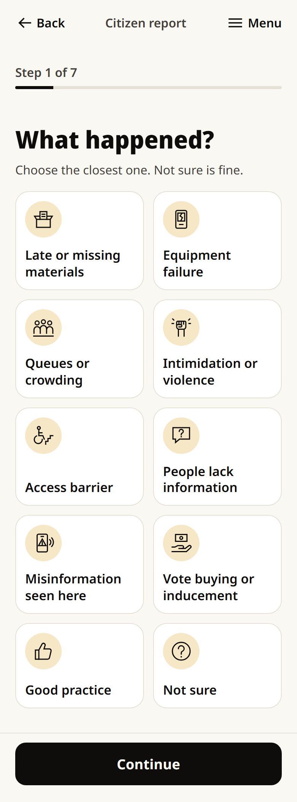
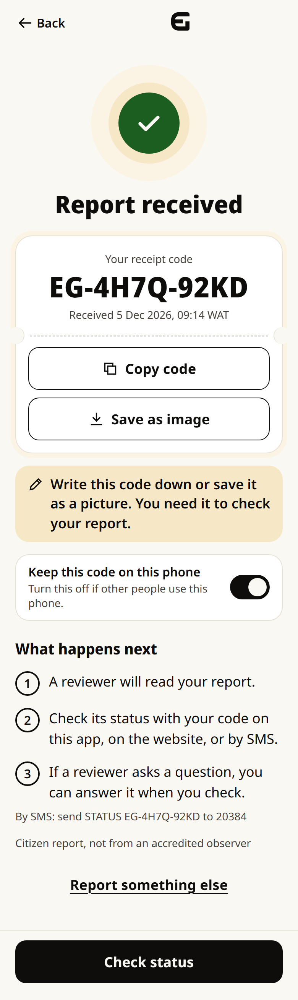
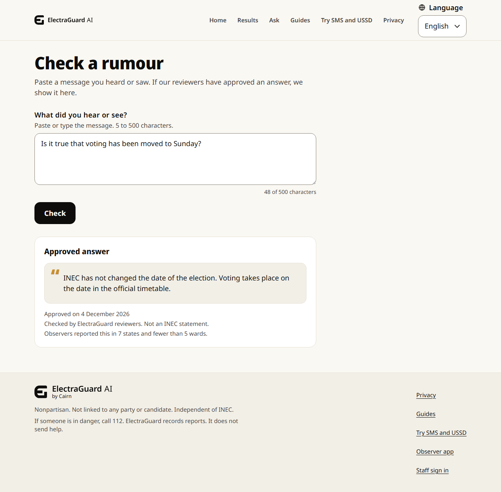
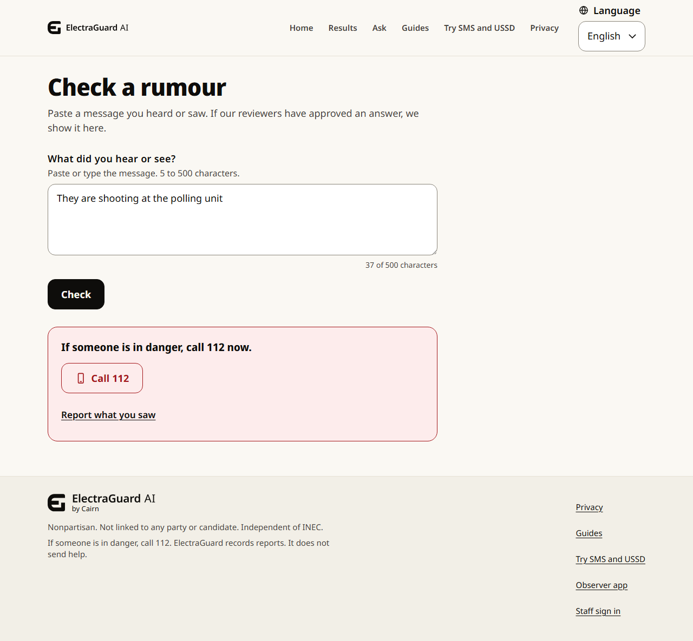

# Citizen and Voter Guide

ElectraGuard AI provides everyday Nigerian voters and community members with direct, private tools to report election incidents, track resolutions, and verify rumours on election day.

---

## 1. Reporting an Incident Without an Account

Citizens can file a report directly from their mobile browser without creating a username, password, or account.

1. Go to the public homepage and tap **Report as a Citizen** (or navigate to `/report`).
2. Select what you saw:
   - Delayed opening or missing election officers.
   - Faulty BVAS or accreditation delays.
   - Intimidation, violence, or security disruptions.
   - Vote buying or financial inducement.
   - Barrier preventing elderly or disabled voters from voting.
   - Other polling day irregularities.
3. Select the Polling Unit, Ward, or LGA where the incident occurred.
4. Provide a brief description of what happened.
5. Optionally attach a photo or audio note as evidence.

> **Privacy Safeguard:** Your phone number and personal details are never requested. If a personal name or phone number is mentioned in the text, it is automatically redacted into an anonymous code (such as `[PHONE_xxxx]`) before anyone reads it.



---

## 2. Your Receipt Code

When you submit a report, the screen generates a unique **Receipt Code** (such as `EG-92D1-B48C`) and a private secret key stored only in your browser.

- **Keep this code:** Take a screenshot or write it down.
- Because you do not have an account, your receipt code is the only key that lets you look up what the situation room did with your report.
- The receipt timestamp is recorded in West Africa Time (WAT).



---

## 3. Checking Report Status and Following Up

To see whether situation-room analysts have reviewed your report:

1. Navigate to `/receipt` on the public website.
2. Enter your 8-character receipt code.
3. You will see the current live status:
   - **Received:** Saved in the queue, awaiting reviewer assignment.
   - **In review:** A situation-room reviewer is actively investigating.
   - **Question for you:** The reviewer needs one clarification. You can submit your answer directly on the receipt page without signing in.
   - **Closed:** The case was verified or resolved, with a nonpartisan summary outcome noted.


---

## 4. Checking Election Rumours (Web Check)

During elections, unverified claims and fake news circulate rapidly on WhatsApp and social media (for example: *"INEC has cancelled voting in Ward 4"* or *"Voting extended until Sunday"*).

Before sharing a claim, check it on ElectraGuard AI:
1. Navigate to `/check` on the public website.
2. Paste or type the claim in any language (English, Naijá, Hausa, Yorùbá, or Igbo).
3. Tap **Check claim**.

### What the Results Mean
- **Verified Fact-Check:** If situation-room fact-checkers have already verified or debunked the claim, you will see the official ruling, source reference, and relevant verified observer reports from that area.
- **Safety Alert:** If the claim involves an active security danger or armed conflict, an immediate safety advisory is displayed advising citizens to stay away from the area.
- **Queued for Review:** If the claim has not been checked yet, the platform logs it with the situation-room rumour desk. Once fact-checkers review it, the answer will appear on `/check`.





---

## 5. Basic Phone Access: SMS and USSD

ElectraGuard AI works on basic feature phones without internet access via SMS and USSD.

> **Operational Notice:** In this prototype deployment, the USSD string (`*384*24#`) and SMS short code (`38424`) run on the built-in on-screen phone simulator at `/phone`. In a production electoral deployment, these connect to commercial telecom short codes leased through Nigerian telecommunications aggregators (MTN, Airtel, Glo, 9mobile).

### Using USSD (`*384*24#`)
1. Dial `*384*24#` on your mobile phone.
2. An interactive text menu opens:
   ```text
   ElectraGuard AI
   1. Report an issue
   2. Check a rumour
   3. Check report receipt
   4. Change language
   ```
3. Follow the numbered prompts to select your LGA, choose the issue category, and enter your report.
4. You receive an instant SMS containing your receipt code.

### Using SMS
- **Report an Incident:** Send `REPORT <LGA> <incident details>` to the short code.
- **Check a Rumour:** Send `CHECK <claim text>` (for example: `CHECK ballot boxes arrived in Gwale`). If an approved debunk exists, a 160-character reply is returned immediately in your detected language.
- **Check a Receipt:** Send `STATUS <receipt code>` to receive the latest review outcome.
