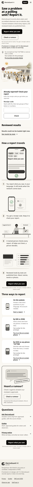
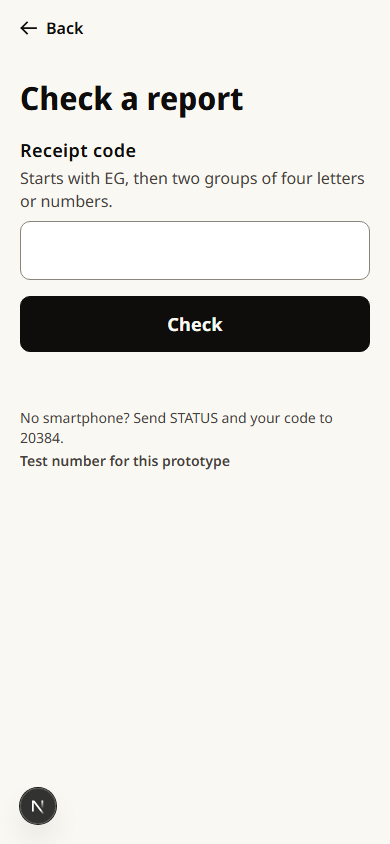
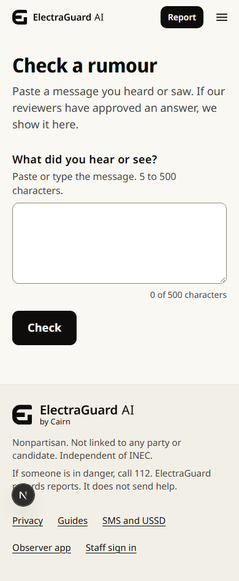
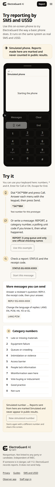
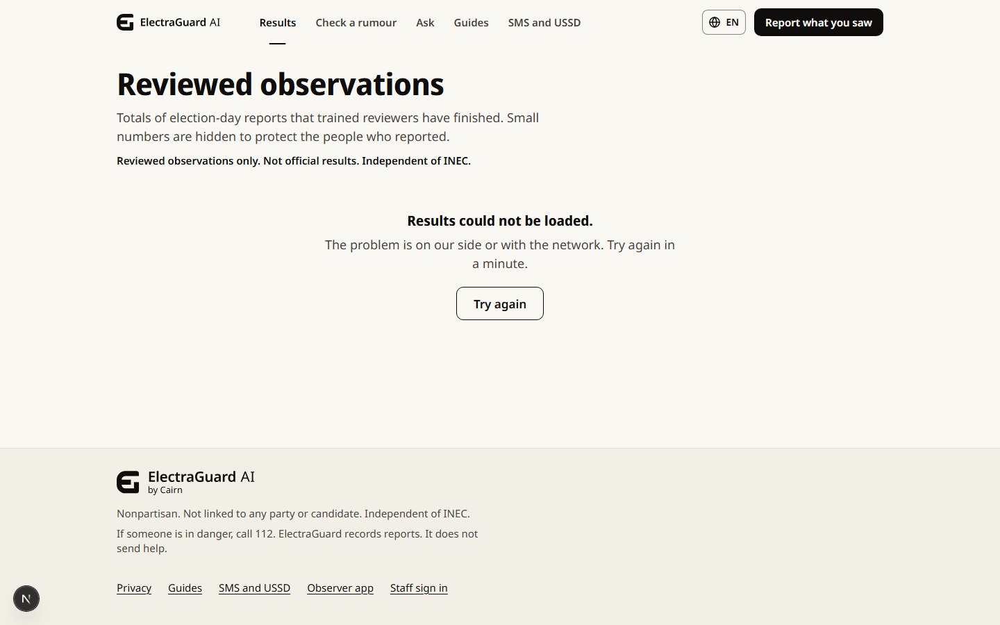

# Citizen and Voter Guide

ElectraGuard lets any voter report a problem at a polling unit without an account and without giving a name, check what happened to the report, and check a rumour against answers that trained reviewers have approved.

Screenshots show the current "Ink and Paper" interface, captured from the development build.

---

## 1. Report what you saw (no account)

1. Open the website home page and tap **Report what you saw** (it opens `/o/new/what?as=citizen`).
2. Answer the same seven short steps observers use: what happened, whether anyone is in danger, where, when, what you saw, optional photos, video or voice, then check and send.
3. If someone is in danger, call **112** first. ElectraGuard records reports; it does not send help.

You never give a name. If a phone number or personal name appears in your text, the system hides it with a token before reviewers read it.

---

## 2. Your receipt code

After sending you see **Report received** and a receipt code that looks like `EG-4H7Q-92KD`. Write it down or save it as a picture. With no account, the code is the only way to follow your report. The screen also shows how to check by SMS.

The phone that sent the report also keeps a private secret. You can look up the status from any device, but you can only answer a reviewer's question on the phone that sent the report.

---

## 3. Check your report

Go to `/status` (**Check a report**) and enter the receipt code. You see the status (Received, In review, Question for you, Closed or Withdrawn) and what was reported. If a reviewer has a question, answer it there on the same phone. You can withdraw a report until a reviewer starts on it.

---

## 4. Check a rumour

Go to `/check` (**Check a rumour**), paste or type the message (5 to 500 characters) and tap **Check**.

- If reviewers have approved an answer, you see it with the date it was approved, marked "Checked by ElectraGuard reviewers. Not an INEC statement."
- If not, you see "We have not checked this yet" and can ask the reviewers to check it. They are told, and the answer appears later.
- If a message suggests someone is in danger, the page tells you to call 112.

---

## 5. Basic phones: SMS and USSD

> **Prototype notice.** The SMS number **20384** is a test number for this prototype, and the USSD code is **\*347\*88#**. Neither is connected to a mobile network yet. They run on the on-screen phone at `/phone`. A commercial short code has to be leased from a telecom operator before real phones can use them.

On the simulator, or once connected:

- **USSD \*347\*88#:** choose a language (English, Naija, Hausa, Yoruba, Igbo), choose what happened from the numbered list, say whether anyone is in danger, choose the state and LGA, write up to 140 characters, then confirm. Your receipt code is shown and sent by SMS.
- **SMS to 20384:**
  - `REPORT 3 Long queue and only one official checking names`: a report, with the category number first (a polling unit code may follow it).
  - `STATUS EG-4H7Q-92KD`: the status of a report.
  - `REPLY EG-4H7Q-92KD <answer>`: answer a reviewer's question.
  - `CHECK <message>`: check a rumour.
  - `LANG EN`, `PCM`, `HA`, `YO` or `IG`: change the language of replies. Reply keywords also exist in each language.

The system stores your phone number only as a scrambled code, never in plain form.

---

## 6. Public results

The **Results** page shows totals of reports that reviewers have finished, by state, type and hour, published at least 60 minutes after the reports. Any number below 5 is shown as "fewer than 5". These are reviewed observations, **not official results**. Only INEC declares results.

