# Field Observer Guide

This guide explains how an accredited election observer uses the ElectraGuard observer app on voting day. The app runs in a mobile browser, keeps working when the network drops, and never asks for your name, email or phone number.

Screenshots show the current "Ink and Paper" interface, captured from the development build with sample data.

---

## 1. Choose your language

On first opening the app you choose a language: **English**, **Naijá** (Nigerian Pidgin), **Hausa**, **Yorùbá** or **Igbo**. You can change it later in **Settings**. The whole interface is available in all five.

---

## 2. Sign in with your observer code and PIN

Your observation organisation prints a card for you with an **observer code** and a **setup PIN**.

1. On the "Who are you?" screen (`/o/start`) choose **I am an accredited observer**.
2. Enter the observer code from your card. Codes look like `OBS-7K2P9X`.
3. Enter the **8-number setup PIN** on your card.
4. The first time, the app asks you to **choose your own 6-number PIN**. It refuses PINs that are easy to guess, such as 123456 or a birth year, and the one on your card.
5. From then on you sign in with the code and your 6-number PIN.

You need network to sign in. After 5 wrong tries in 15 minutes the code is locked for 15 minutes. After 10 wrong tries in 24 hours it stays locked until your coordinator resets it.

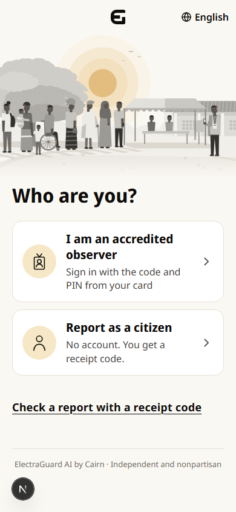
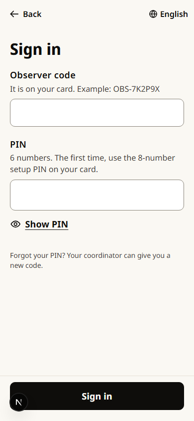

The app does not ask for your name. The organisation that issued your card knows who holds each code; ElectraGuard itself does not store that link.

---

## 3. Home

Home shows a greeting, your observer code, **Report something**, **My reports**, the **Polling-day checklist**, **Messages**, **Discussions** and **Ask ElectraGuard**. A bar at the top tells you when you are offline. The bottom bar has **Home**, **Report**, **My reports** and **Messages**.

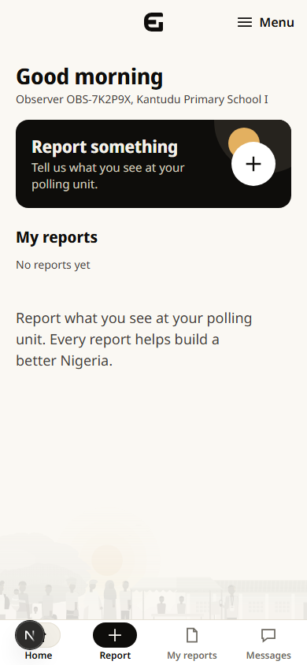

---

## 4. Report an incident

A report is seven short screens, each marked "Step n of 7". Your answers are saved on the phone as you go, so you can leave and continue from Home.

1. **What happened?** Pick a picture tile: Late or missing materials, Equipment failure, Queues or crowding, Intimidation or violence, Access barrier, People lack information, Misinformation seen here, Vote buying or inducement, Good practice, or Not sure. "Access barrier" asks a follow-up about the kind of barrier.
2. **Is anyone in danger right now?** If you answer yes, the app first shows "Get safe first": move away, call 112, tell your coordinator. The app does not send help; reports go to reviewers, not to the police.
3. **Where did it happen?** Search by polling unit code or name, tap "Use my polling unit today", or choose state, LGA and ward. If you do not know the unit you can report by ward only. The app never uses your phone's GPS.
4. **When did it happen?** Just now, Earlier today, or Another day. Times are West Africa Time.
5. **Tell us what happened.** Type, or use Speak. Say who was affected by role, not by name; the app warns you if the text may name a person.
6. **Add photos, video or voice (optional).** Up to 6 items per report: video up to 60 seconds, voice notes up to 2 minutes. Location data is removed from photos on your phone and again on the server. Faces the detector finds are blurred.
7. **Check and send.** Review each part, tap **Change** to fix anything, then **Send report**.

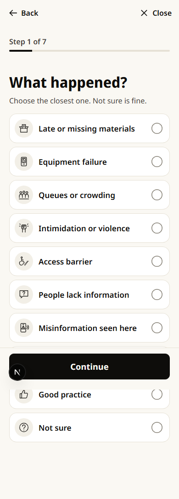
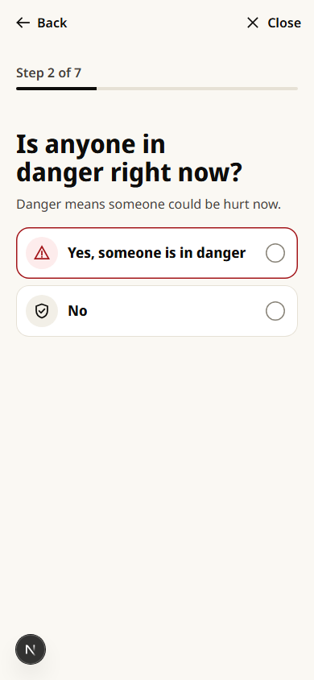
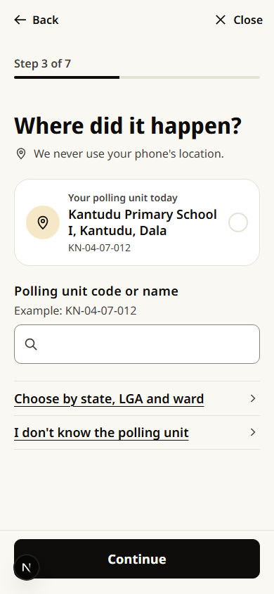
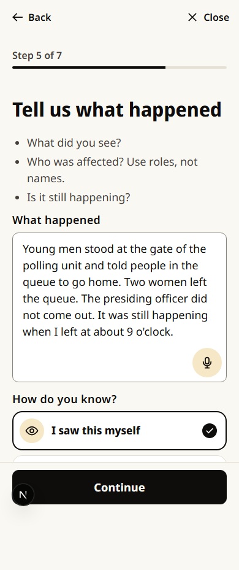
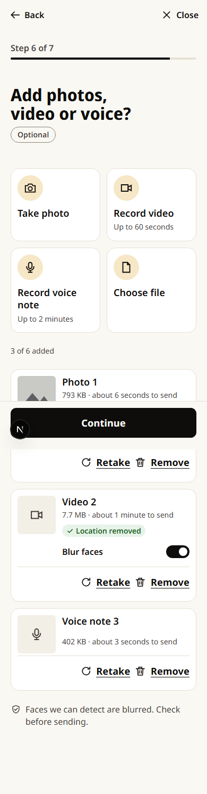
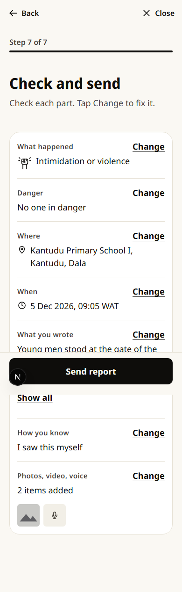

---

## 5. Receipt

When the server has received the report you see **Report received** and a **receipt code** such as `EG-4H7Q-92KD`. You can copy it. The screen shows each attachment uploading until it says Saved; keep the app open until then.

You can withdraw a report from **My reports** until a reviewer starts on it. Withdrawing deletes your text and files.

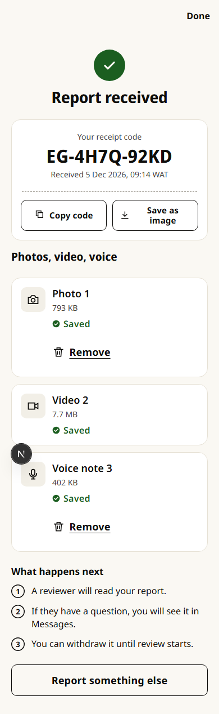

---

## 6. No network

If there is no network, **Send report** becomes "Save and send when online". The report waits in the outbox on the phone, and the app sends it by itself when the network is back, in the order you made them. Keep the app open while it sends.

The outbox is stored in the browser on the phone. It is not additionally encrypted by the app. On a shared phone use **Settings > Sign out and clear this phone**, which removes drafts, saved reports and messages from the phone.

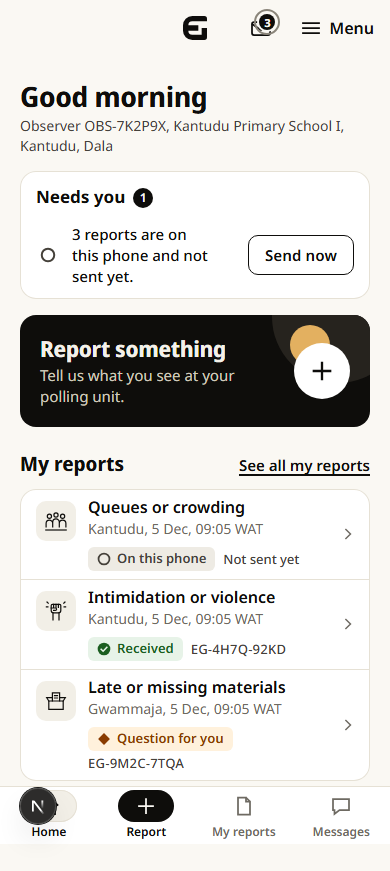

---

## 7. Messages from reviewers

When a reviewer needs more information, the report shows **Question for you** and Home shows a banner. Open **Messages** or the report, type your answer and tap **Send answer**. You can also write a plain message to the reviewer at any time and attach a photo or voice note.

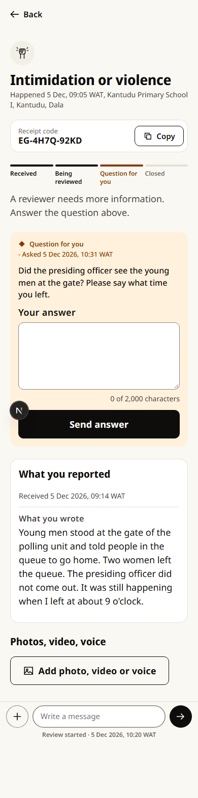

---

## 8. Polling-day checklist

The checklist has six stages: **Arrival, Opening, Accreditation, Voting, Closing and counting, Results posted**. Each stage is a few yes/no or choice questions (for example "Did it open on time?", "Was the accreditation device working?", "How big was the queue?"). Each stage is sent on its own and also works offline. "I did not see" is always a valid answer. A stage can be turned into an incident report with one tap.

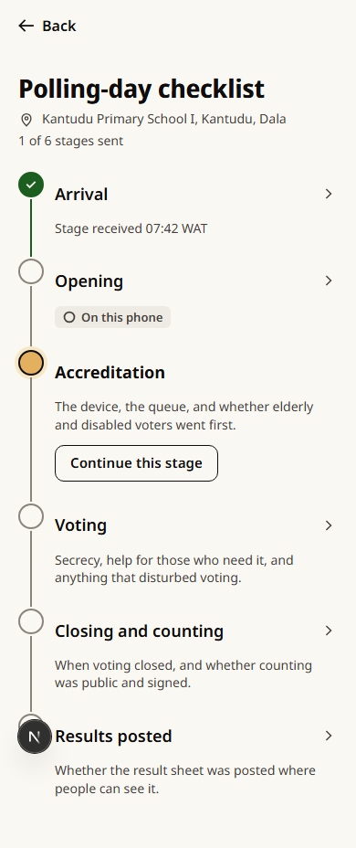

---

## 9. Result sheet check

From the checklist's final stage you can **Check the result sheet**. Photograph the sheet that was posted for the public. The app can try to read the numbers from the photo, but that needs a local reading engine (Tesseract) on the server. If it is not installed, the app says "Photo reading is unavailable. Type the numbers instead." and you type them. Either way, check and type exactly what the sheet shows: registered voters, accredited voters, votes for each party and rejected ballots. Tick the box to confirm you checked every number and send for review.

Reviewers see consistency flags: accredited voters exceed registered voters, votes plus rejected ballots differ from the accredited count, two digits that may be swapped, unusually round numbers, or numbers identical to another unit's sheet. The screen says: "Consistency check for review. This is not a result." ElectraGuard never adds up votes or names a winner.

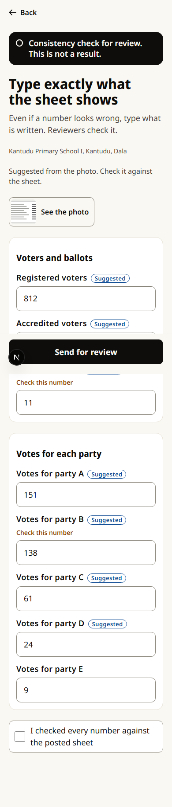

---

## 10. Check-ins and discussions

- **Check-ins.** A coordinator can ask observers in a ward or LGA a short question. A banner on Home asks you to answer **Yes**, **No** or **Not seen**. You can answer offline; it is sent with the time you answered.
- **Discussions.** A moderator may invite you to talk with other observers in your area about a shared problem. Others see only your observer code and what you write. Write the ward, never a polling unit, and no names or phone numbers.
- **Ask ElectraGuard.** The answer is the paragraph of an approved guide that best matches your question, quoted word for word and shown with its page and section. Nothing is written by the system. Signed in, you can also get answers from pages meant only for observers. If no approved paragraph matches, the app says so. A page not yet written in your language is shown in English.
