# Field Observer Guide

This guide explains how an accredited election observer uses ElectraGuard AI on voting day. The observer web application runs in any modern mobile browser, works without an internet connection, and never asks for your name or phone number.

---

## 1. Choosing Your Language

When you first open ElectraGuard AI, choose the language you prefer:
- **English**
- **Naijá** (Nigerian Pidgin)
- **Hausa**
- **Yorùbá**
- **Igbo**

You can switch your language at any time from the bottom of any screen or the settings tab.

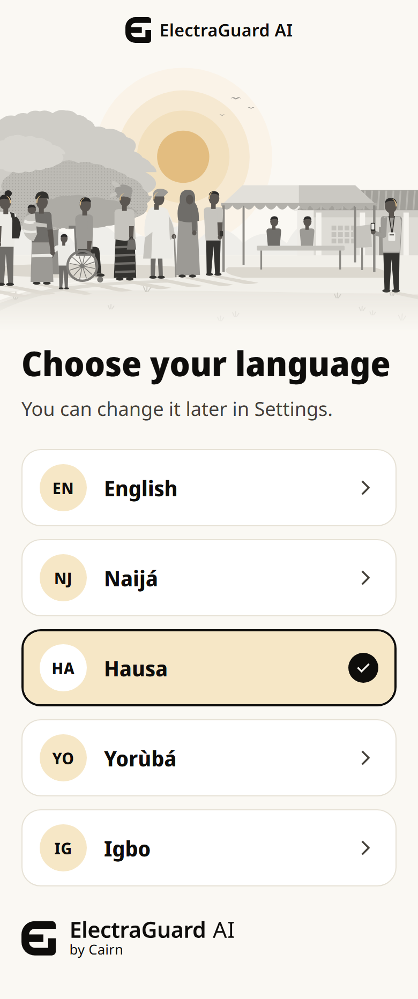

---

## 2. Signing In with Observer Code and PIN

Your election observation organisation issues you an **Observer Code** and a temporary **6-digit PIN** before deployment.

1. Navigate to `/o/sign-in` (or tap **Observer Sign-in** on the home screen).
2. Enter your 8-character code (for example: `OB-7K4M2`).
3. Enter your 6-digit PIN.
4. If this is your first sign-in, you will be prompted to set your personal secret PIN.

> **Privacy Guarantee:** ElectraGuard AI does not collect your name, phone number, email address, or National Identity Number. If your phone is inspected or seized at a polling unit, there is nothing on the device connecting your personal identity to the reports filed.

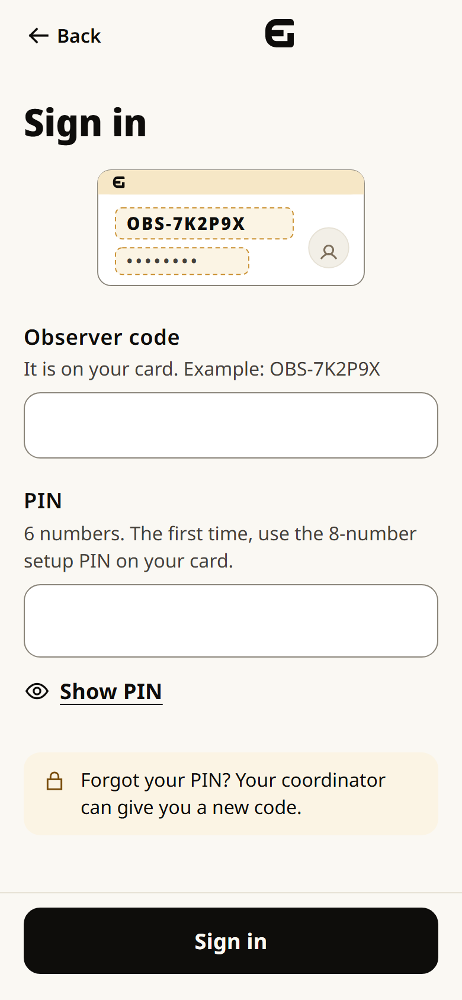

---

## 3. The Observer Home Screen

After signing in, you reach the observer home screen. The top bar shows your current network status (**Online** or **Working offline**) and your assigned Local Government Area.

From this screen you can access:
- **Report Something:** Start a new incident report.
- **Polling Day Checklist:** Open your stage-by-stage monitoring checklist.
- **Result Sheet (Form EC8A):** Record official vote counts once counting concludes.
- **My Reports:** View your filed reports, receipts, and reviewer messages.
- **Outbox:** Check reports waiting to upload.

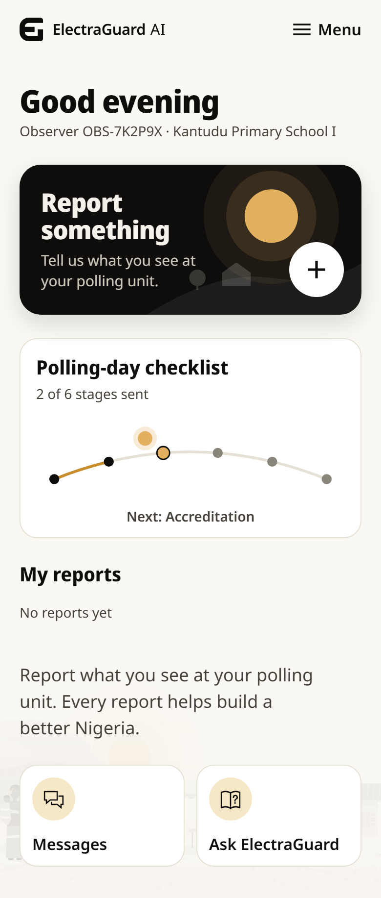

---

## 4. Reporting an Incident Step by Step

Filing an incident report takes seven simple steps.

### Step 1: What Happened?
Select the category that best matches what you witnessed:
- **Late arrival of materials** (ballot boxes, BVAS, ballot papers)
- **BVAS issues** (biometric accreditation failure or power loss)
- **Intimidation or violence** (threats, fighting, or weapon display)
- **Vote buying or inducement** (cash, food, or token distribution)
- **Access barrier** (canopy, wheelchair, or security barricade)
- **Counting or procedure dispute**
- **Other issue**

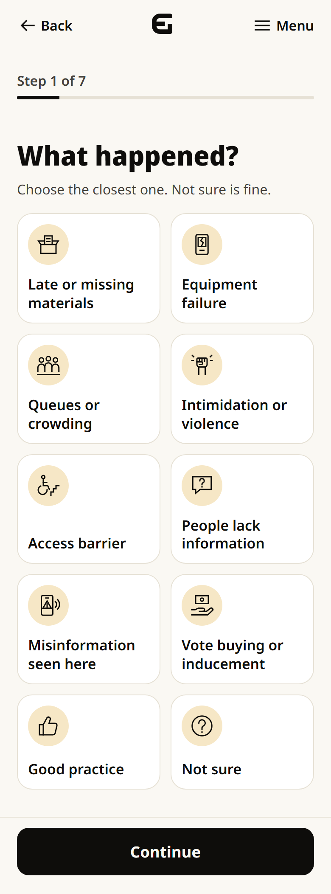

### Step 2: Immediate Danger
Answer whether anyone is in immediate danger right now.
- If you select **Yes**, the platform marks your report as **Urgent**, alerting situation-room reviewers within 15 minutes.
- You are shown emergency contact advice: *Your personal safety comes first. Move to a safe location before continuing.*

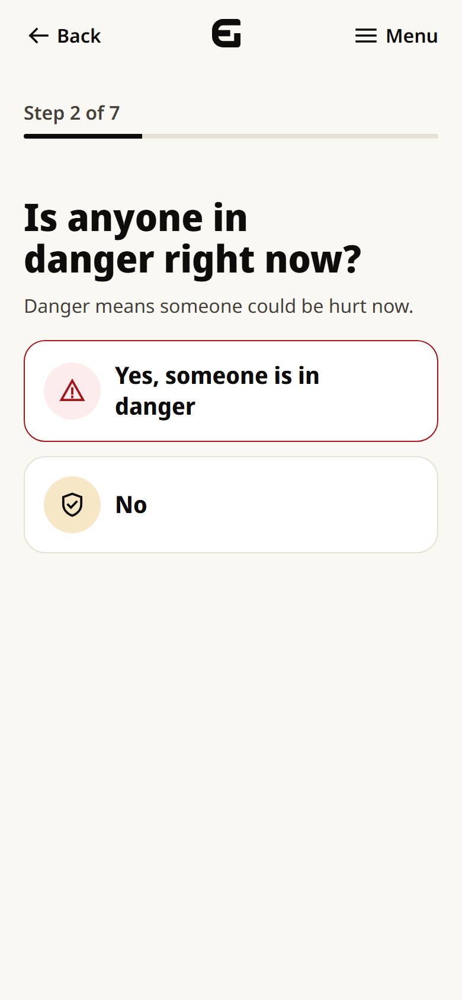

### Step 3: Where Did It Happen?
Confirm your polling unit location. You can select your assigned polling unit with one tap or search by Ward or Polling Unit Code (for example: `012/04/01`).

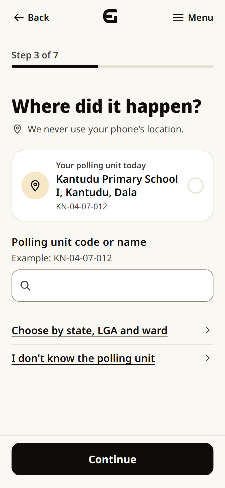

### Step 4: When Did It Happen?
Choose whether the event happened **Just now**, **Earlier today**, or at an exact time.

### Step 5: Describe What You Saw
Write a brief, factual description.
- Stick to what you witnessed firsthand.
- Avoid recording bystander names. If you accidentally type a Nigerian phone number, voter card number, or full personal name, the system redacts it automatically.

### Step 6: Evidence (Photos & Audio)
Add evidence when it is safe to do so:
- **Photos:** Up to 6 photos per report.
- **Voice Notes:** Record short audio notes explaining the situation.
- Faces in photos and videos are automatically blurred by the server before any staff review to protect people on site.

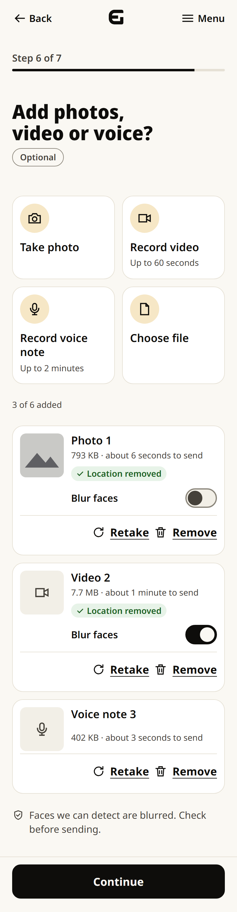

### Step 7: Check and Send
Review your report summary. Tap **Submit Report**.

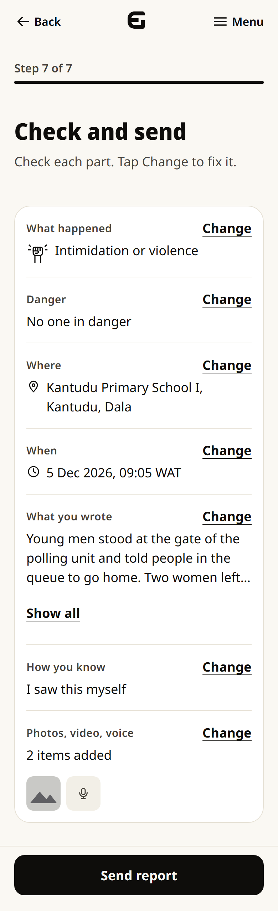

---

## 5. Offline Operation and the Outbox

ElectraGuard AI is built offline-first using browser ServiceWorkers and IndexedDB local storage:
- If cellular signal drops to 2G, 1G, or disconnects completely, you will see a gentle indicator: **Saved on this phone**.
- Your report is encrypted and saved into the local **Outbox**.
- You can continue completing checklists, entering result sheets, and filing new reports.
- As soon as your phone detects connectivity, the outbox automatically uploads queued items in the background. You do not need to keep the screen open or re-enter details.

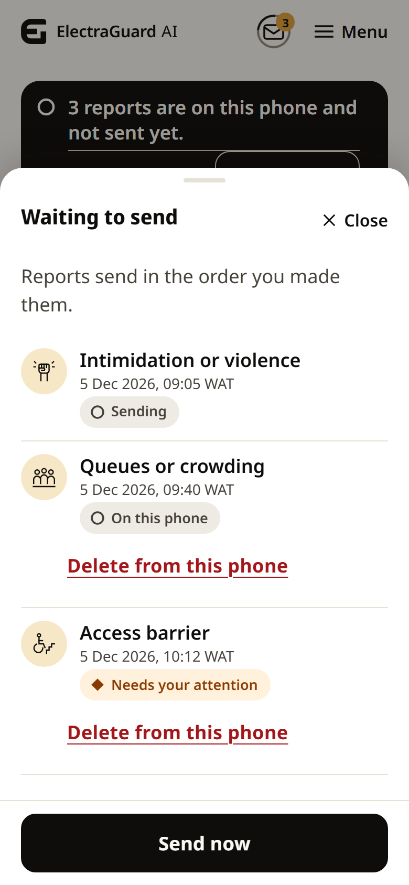

---

## 6. Report Receipts and Tracking

Every submitted report generates an official **Receipt Code** (such as `EG-88F4-A92B`).

- Your receipt proves that your report reached the situation room database.
- The receipt timestamp is stored in West Africa Time (WAT).
- You can share the receipt code with your team lead to verify submission.

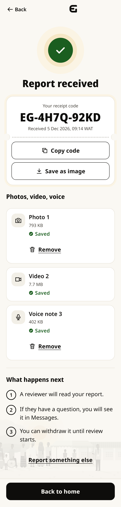

---

## 7. Answering Reviewer Questions

When a situation room reviewer needs more information (for example: *"Did polling officials resume voting after the rain stopped?"*), your report status changes to **Question for you**.

1. Tap the notification on your home screen or open **My Reports**.
2. Read the reviewer's question.
3. Type your reply and attach extra photos if available.
4. Tap **Send Reply**. The review clock resumes immediately.

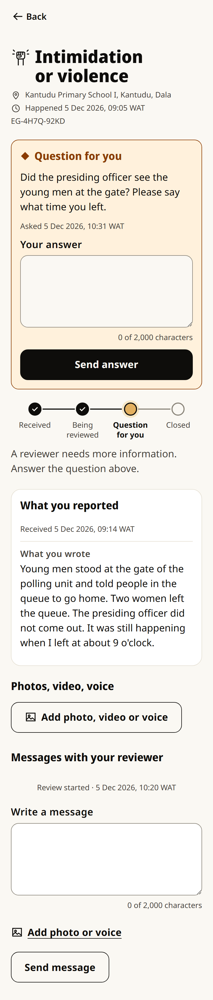

---

## 8. The Polling-Day Checklist

The checklist tracks the four standard phases of voting day:
1. **Setup & Opening (07:30–08:30):** Officials present, ballot box shown empty and sealed, security officers present, party agents verified.
2. **Accreditation & Voting (08:30–14:30):** BVAS functioning, voter register checked, secrecy of the ballot booth preserved.
3. **Closing & Sorting (14:30+):** Queue cutoff at 14:30 enforced, unused ballots cancelled.
4. **Counting & Announcement:** Ballots sorted and counted loudly in public view, results recorded on Form EC8A.

Checklist answers can be filled offline and sync automatically.

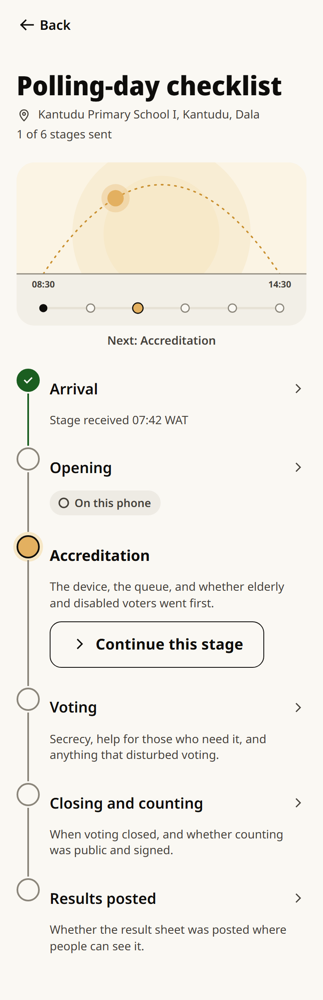

---

## 9. Result Sheet Transcription (Form EC8A)

At the end of counting, polling officials complete and sign Form EC8A.

1. Tap **Result Sheet** from the home screen.
2. Take a clear, well-lit photo of the physical paper sheet.
3. Enter the numerical totals:
   - Registered Voters in polling unit.
   - Accredited Voters on BVAS.
   - Votes scored by each political party.
   - Rejected / spoiled ballots.
4. **Automatic Consistency Check:** The platform immediately checks two arithmetic rules:
   - Total votes cast cannot exceed accredited voters.
   - Sum of party votes + rejected ballots must equal total votes cast.
   - If numbers do not balance, the screen flags the arithmetic inconsistency before submission.

> *Note:* Result sheet transcription is for observer verification and collation reconciliation only. It is **not** an official declaration of results.

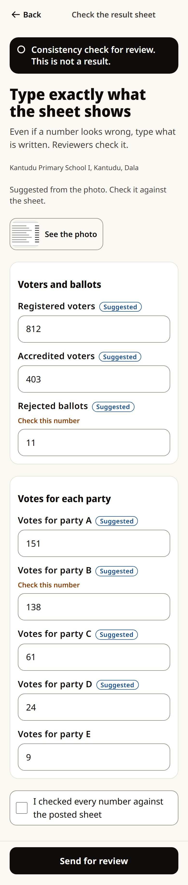

---

## 10. Responding to Ward Check-Ins

During voting, situation-room coordinators may send a **Ward Check-in** asking all observers in an LGA or Ward a quick status question (for example: *"Are voting materials present at your unit as of 10:00?"*).

- An alert banner appears on your home screen with simple response options (**Yes**, **No**, **Partial**).
- One tap logs your response and updates the situation-room live operations map.
