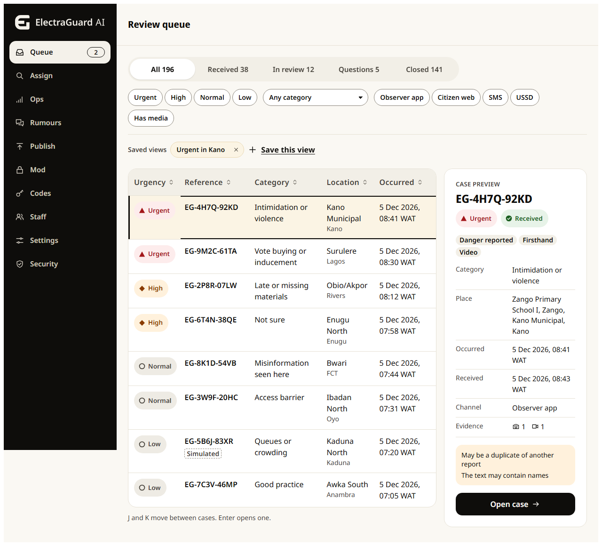
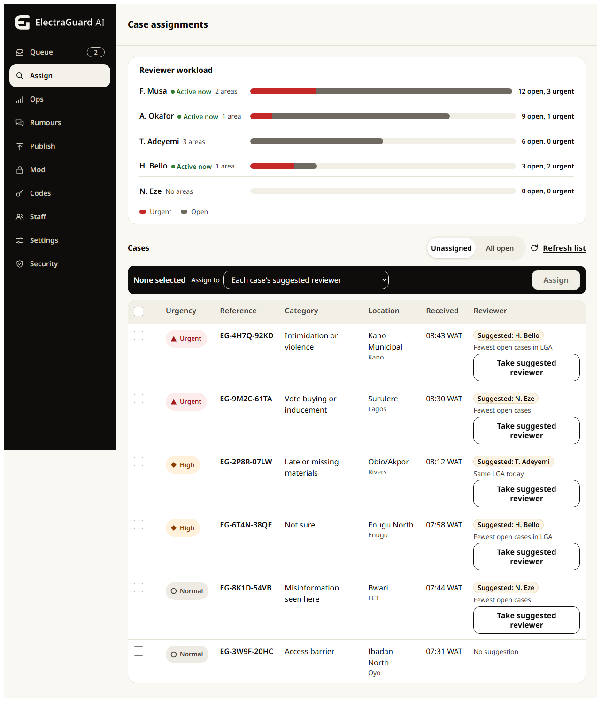
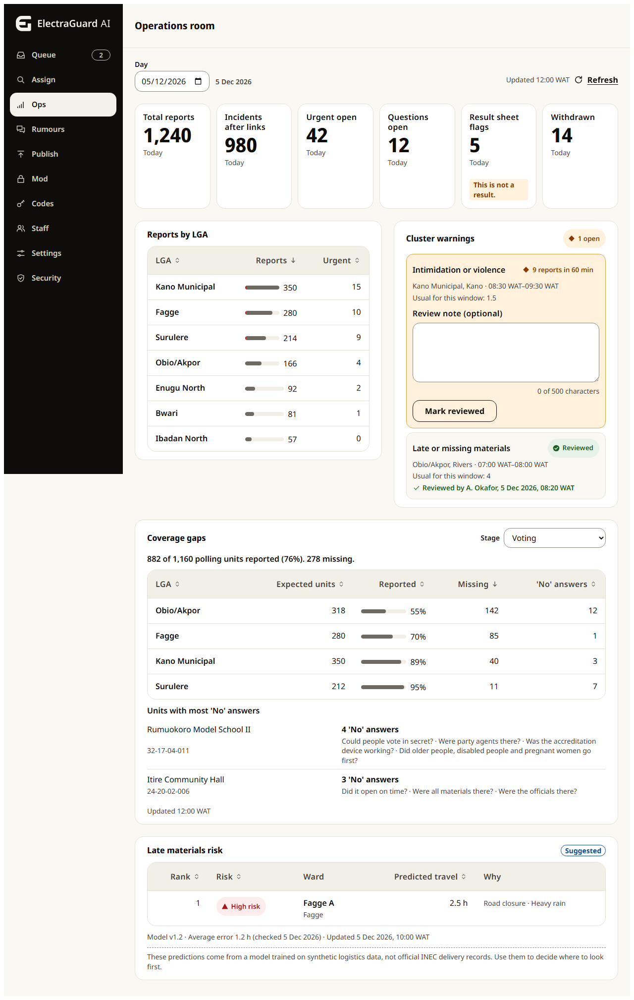
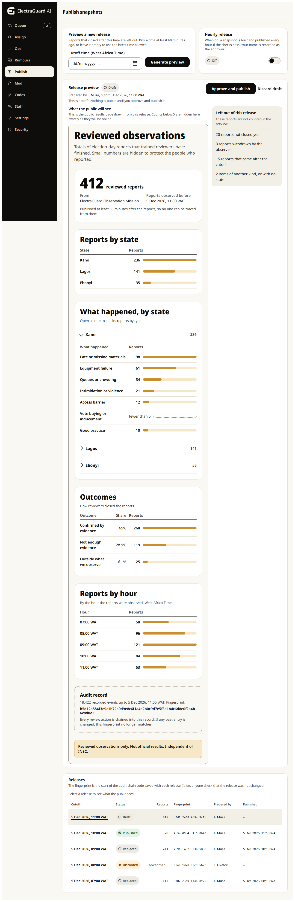
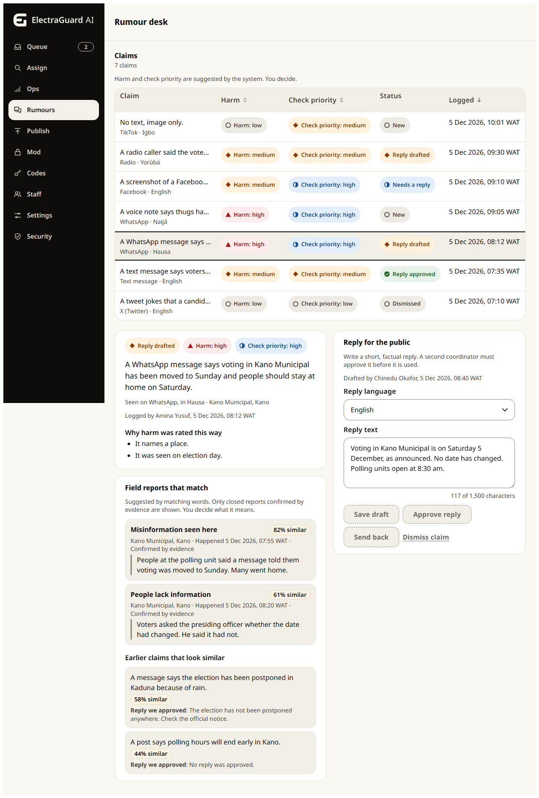
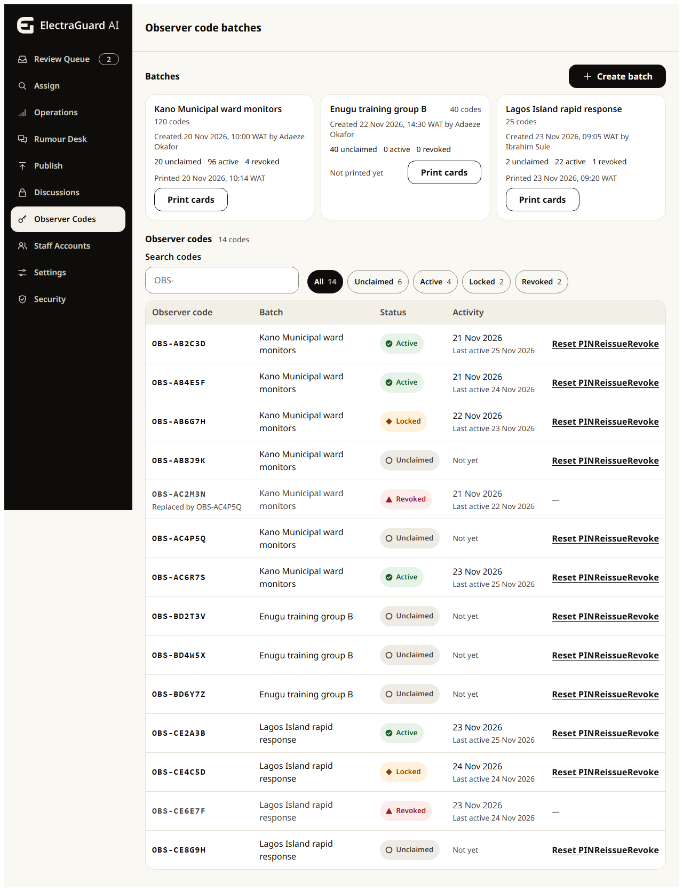
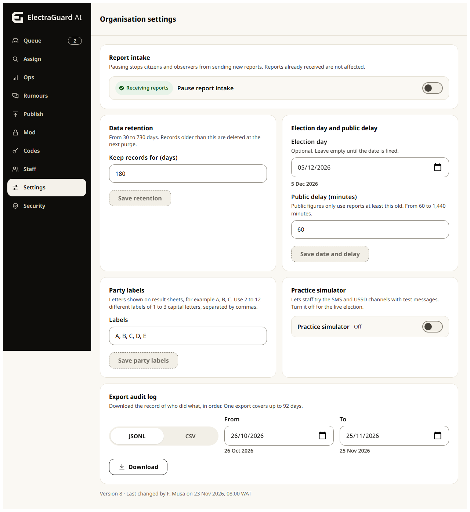
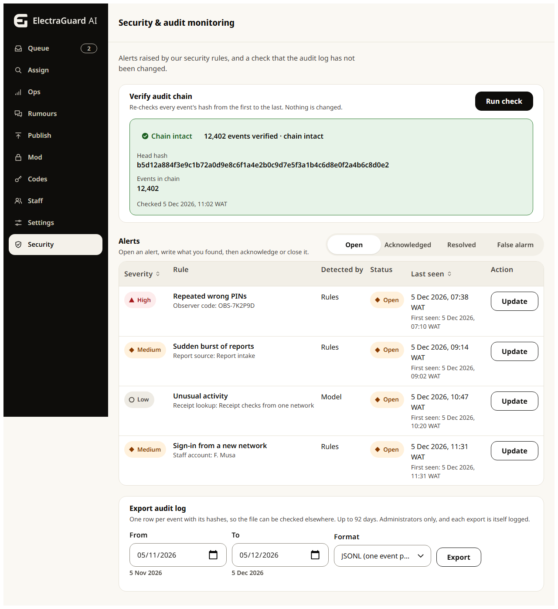

# Situation Room Staff Guide

This guide covers situation-room operations in ElectraGuard AI. It describes the four staff roles, how incoming incident queues are handled, review clock enforcement, rumour verification, ward check-ins, safety advisories, and cryptographic transparency publishing.

---

## 1. Staff Roles and Permissions

ElectraGuard AI uses strict role-based access control (RBAC):

| Role | Primary Responsibilities | Main Screens |
|---|---|---|
| **Reviewer** | Investigates assigned incidents, redacts personal details, asks clarification questions, and closes cases. | Queue (`/workspace/queue`), Case Detail (`/workspace/cases/[id]`) |
| **Coordinator** | Manages case distribution, monitors operations overview, issues ward check-ins, approves safety alerts, and schedules public releases. | Operations Room (`/workspace/operations`), Case Assignment (`/workspace/assignment`), Publishing (`/workspace/publishing`) |
| **Moderator** | Researches viral election claims, verifies sources, and drafts approved fact-checks for the public rumour check. | Rumour Desk (`/workspace/rumours`), Discussions Moderation (`/workspace/discussions`) |
| **Administrator** | Provisions staff accounts, generates observer code batches, configures organisation review targets, and audits cryptographic security. | Observer Codes (`/workspace/codes`), Staff Accounts (`/workspace/staff`), Settings (`/workspace/settings`), Security Audit (`/workspace/security`) |

---

## 2. The Reviewer Workflow

### The Queue (`/workspace/queue`)
Reviewers manage incidents in an active queue sorted by urgency, danger, and regulatory deadline:
- **Urgency Badges:** **Urgent** (red triangle), **High** (amber diamond), **Normal** (blue semi-circle), **Low** (grey circle).
- **Review Clocks:** Each item displays a live countdown timer showing minutes remaining before a regulatory breach. Clocks turn red and count negative when overdue.
- **Filter Bar:** Filter by category, urgency, channel (App, Citizen, SMS, USSD), state, LGA, and clock state (`on_time`, `due_soon`, `overdue`).

### Reviewing an Incident Case (`/workspace/cases/[id]`)
Opening an incident displays the unified case workspace:
1. **Auto-Redacted Description:** Personal names, phone numbers, and voter card numbers are replaced with tokens (`[NAME_xxxx]`, `[PHONE_xxxx]`) to prevent unconscious bias and safeguard reporters.
2. **AI Triage Suggestions:** Calibrated models suggest the category and urgency level. Reviewers can **Accept** the suggestion or **Correct** it with a single click.
3. **Review Clock:** Shows the active deadline (urgent: 15 min, high: 60 min, normal: 240 min).
4. **Case Actions:**
   - **Start Review:** Moves the status from `received` to `in_review`.
   - **Ask Question:** Sends a targeted clarification prompt to the observer or citizen. This pauses the first-action clock until a reply arrives.
   - **Close Case:** Concludes the review, recording a required nonpartisan outcome rationale.

### Controlled Original Access (CASE-06)
If unredacted text is strictly necessary to investigate a life-safety issue:
- Click **View Original**.
- Enter a mandatory written justification (1–500 characters).
- The action is rate-limited to 30 requests per hour per reviewer and immediately logged as a permanent `case.original_viewed` audit event.

---

## 3. The Coordinator Workflow

### Case Assignment (`/workspace/assignment`)
Coordinators oversee unassigned reports and balance workload across active reviewers:
- Filter unassigned cases by LGA or category.
- Bulk-assign cases to available reviewers.
- Reassign cases if an active reviewer goes offline or exceeds review clock limits.

### Operations Room (`/workspace/operations`)
The operations room provides a real-time operational picture across all polling units:
- **Overdue Clock Summary:** Displays counts of overdue incidents across urgent, high, and normal priorities.
- **Statistical Volume Alerts:** Highlights anomalous spikes detected by dual-window Poisson models and slow multi-hour CUSUM drift detection.
- **Ward Check-Ins:** Broadcasts targeted status checks to all observers in a specific ward (for example: *"Has BVAS accreditation commenced?"*). Responses aggregate into live percentage bars.
- **Dual-Coordinator Safety Advisories:** If a security threat arises, a coordinator can draft an urgent safety notice. To prevent false alarms or panic, safety advisories require **second-coordinator approval** before being broadcast to observers or the public.

### Publishing and Transparency (`/workspace/publishing`)
Coordinators control the release of reviewed data to the public transparency dashboard:
- Create a scheduled publication snapshot.
- Automatic verification enforces the **small-number suppression rule**: any state or LGA cell with fewer than 5 reports (`< 5`) is automatically masked to prevent informant exposure.
- Preview and approve the public release.

---

## 4. The Moderator Workflow: Rumour Desk (`/workspace/rumours`)

Moderators investigate social media rumours and unverified claims:
1. **Incoming Claims:** Claims submitted via the public web form (`/check`), SMS (`CHECK`), or flagged by field observers appear in the rumour queue.
2. **Harm Assessment:** The platform ranks claims by public safety harm and check-worthiness score.
3. **Semantic Matching:** Checks whether the new claim is a variation of an already answered claim.
4. **Drafting Debunks:** Moderators draft clear, nonpartisan answers citing authoritative sources (INEC press releases, verified observer consensus).
5. Once approved, the answer is immediately live on `/check` and SMS across English, Naijá, Hausa, Yorùbá, and Igbo.

---

## 5. The Administrator Workflow

### Observer Code Batches (`/workspace/codes`)
Administrators generate and manage anonymous observer credentials:
- Generate batches of random 8-character codes and temporary 6-digit PINs.
- Print credentials or export secure CSVs for field distribution.
- Reissue PINs or immediately revoke compromised codes.

### Staff Account Administration (`/workspace/staff`)
- Invite new staff members with specified roles (Reviewer, Coordinator, Moderator, Admin).
- Reset credentials and enforce session termination.

### Organisation Settings (`/workspace/settings`)
- **Review Targets:** Configure organisation review target windows (5 to 1,440 minutes) for urgent, high, normal, low, and question-reply clocks.
- **Intake Kill Switch:** Temporarily pause observation intake during maintenance or after official poll closure while preserving existing case workflows.
- **Data Retention Policies:** Enforce automated data pruning windows.

### Cryptographic Security Audit (`/workspace/security`)
- **SHA-256 Audit Chain Verification:** Run on-demand cryptographic verification of the complete event ledger. Confirms that no past report, triage decision, or reviewer action has been altered or deleted.
- **Security Alerts:** Monitor rate-limit triggers, CSRF anomalies, and unauthorized access attempts.

