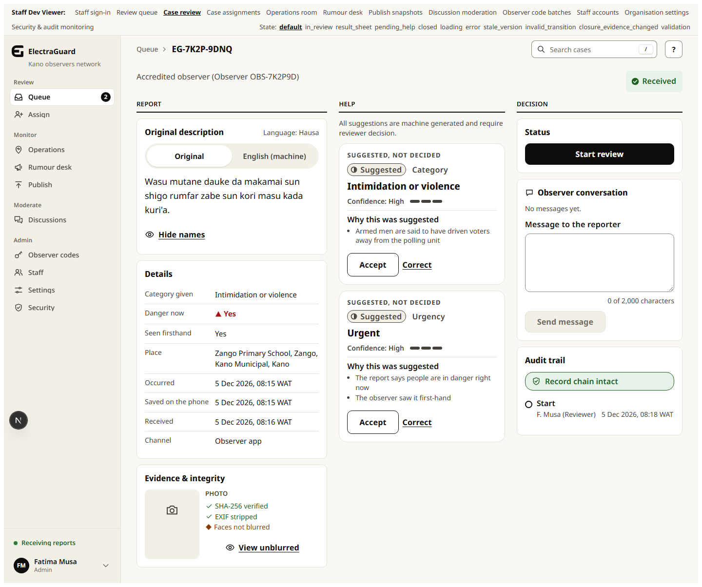
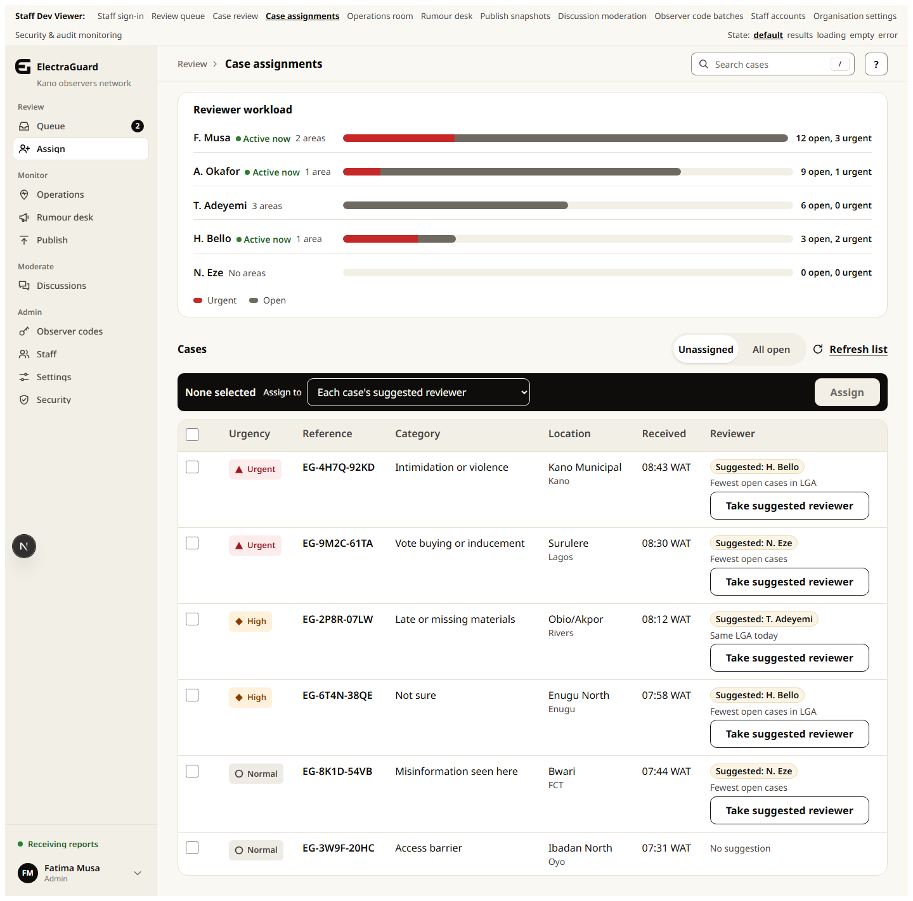
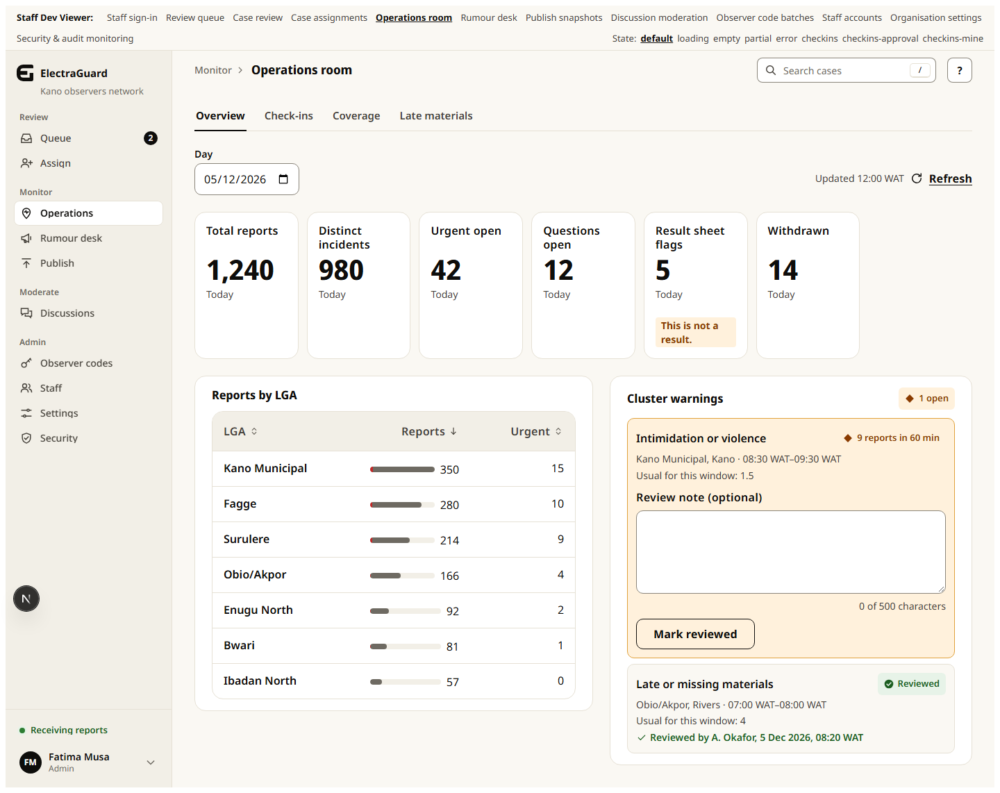
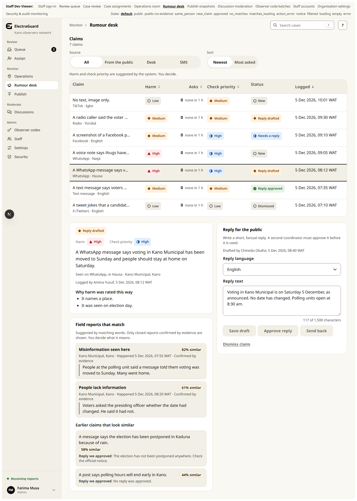
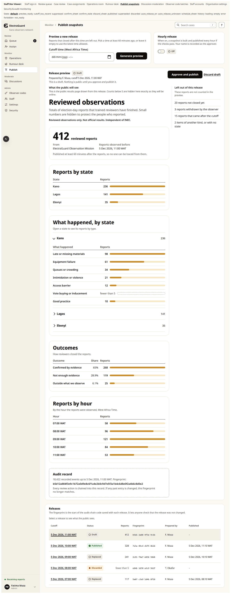
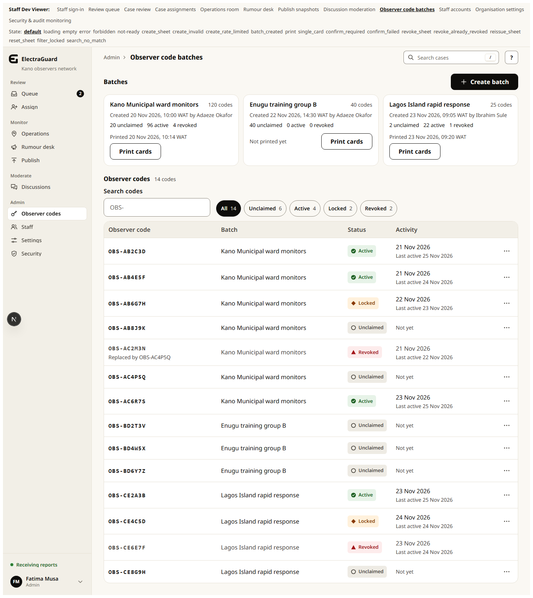
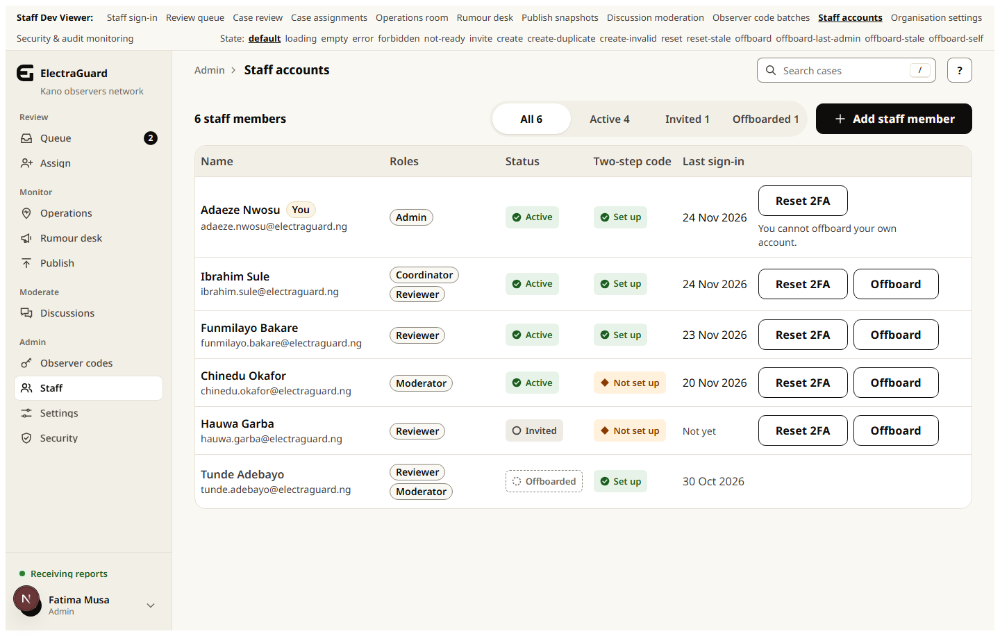
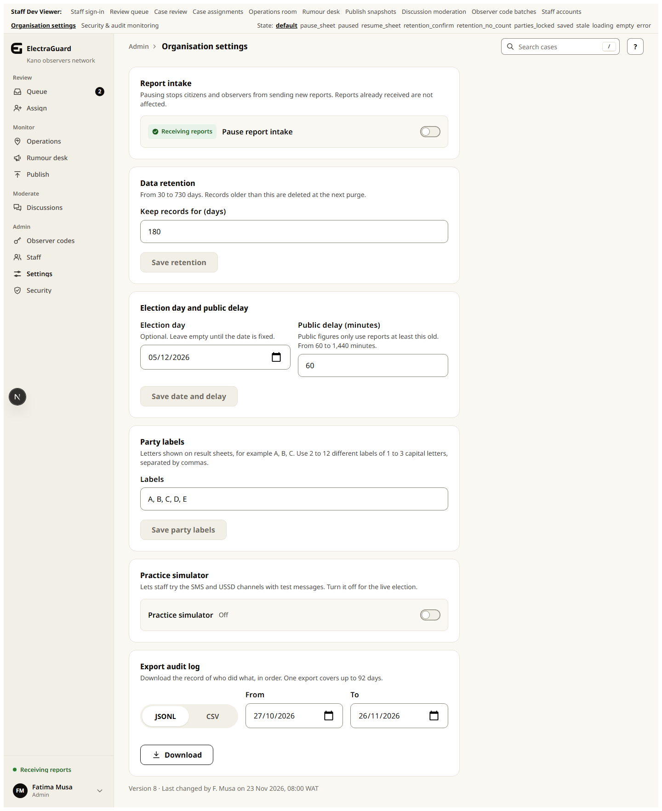
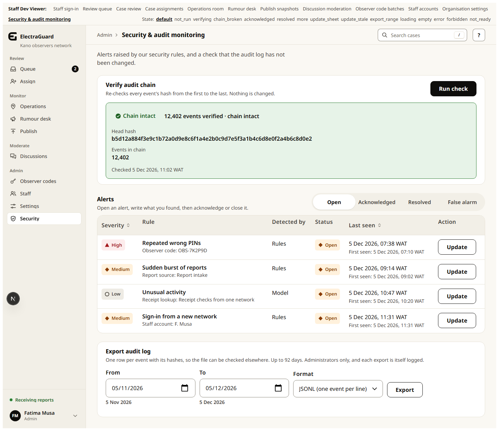

# Situation Room Staff Guide

This guide covers the staff console (`/s/...`) for people at an observation organisation: reviewers, coordinators, moderators and administrators. Screenshots show the current "Ink and Paper" interface, captured from the development build with sample data (the "Staff Dev Viewer" bar at the top of some shots is a development tool, not part of the product).

---

## 1. Signing in and roles

Staff sign in at `/s/sign-in` with a work email, a password, and a six-digit code from an authenticator app (two-step sign-in is required; first-time users are walked through setting it up). Observers do not use this page; they sign in on the observer app.

A person can hold more than one role. The menu shows only what the role allows.

| Role | What they can do | Menu entries |
|---|---|---|
| **Reviewer** | Work the cases assigned to them: start review, ask the reporter a question, accept or correct suggestions, close with an outcome. | Queue |
| **Coordinator** | Assign cases, watch operations, send check-ins and notices, run the rumour desk, publish reviewed results, view security alerts and verify the audit record. | Assign, Operations, Rumour desk, Publish, Security |
| **Moderator** | Moderate observer discussions: hide posts, remove members, close discussions. | Discussions |
| **Admin** | Create observer code batches, manage staff accounts, set organisation settings, view security alerts. | Observer codes, Staff, Settings, Security |

---

## 2. Reviewer: queue and case

**Queue** (`/s/queue`) lists cases assigned to the reviewer, ordered by urgency and danger, with tabs by status (received, in review, waiting on answer). Filters cover status, urgency, category and channel (observer app, citizen web, SMS, USSD) and whether there is media. Each row shows the reasons it ranks where it does (for example "Danger reported", "Firsthand", "Result sheet flag"). Keyboard: J and K move between cases, Enter opens one. Filters can be saved as named views.

**Case** (`/s/cases/<reference>`) has three columns: the report, help, and the decision.

- **Report.** The description, with a switch to an English machine translation (marked as machine translation). The text shown has personal details such as phone numbers, ID numbers and listed names already replaced by tokens. The **Hide names** tool lets the reviewer hide further names before text is shared. Details show the category given, whether danger was reported now, whether it was seen firsthand, the place, and when it happened and arrived. **Evidence and integrity** shows for each file whether its SHA-256 checksum was verified, whether location data was stripped and whether faces were blurred. **View unblurred** needs a written reason, which is recorded in the audit trail, and works only while the file is still being processed.
- **Help.** The system suggests a category and an urgency, always labelled "Suggested, not decided", with its confidence and reasons. The reviewer chooses **Accept** or **Correct**. If the system is not confident it says so and suggests nothing. Possible duplicates are listed side by side; the reviewer chooses **Link as duplicate** or **Keep separate**. For result-sheet reports, consistency flags are shown with possible harmless explanations, under the words "This is not a result."
- **Decision.** **Start review**, **Ask formal question** (the reporter sees it in the app, on the status page or by SMS), message the reporter, and **Close case** with an outcome (Corroborated, Insufficient evidence, Out of scope), an internal rationale that reporters never see, and a confirmation of the evidence considered. The **Audit trail** shows each action and whether the record chain is intact.

The server can also return the full, unredacted original text to the assigned reviewer, but only with a written reason of 1 to 500 characters, at most 30 times an hour, and each use is written to the audit record (API contract CASE-06). This build's case screen does not have a button for it.

---

## 3. Coordinator

**Assign** (`/s/assign`) shows unassigned cases, reviewer workload and a suggested reviewer for each case (fewest open cases, or same LGA today). Select cases and assign them in bulk.

**Operations** (`/s/ops`) has four sections:

- **Overview.** Totals for the day (reports, distinct incidents, urgent open, questions open, result-sheet flags), cluster warnings, reports by LGA, and thresholds for cluster warnings. A cluster warning means more reports than usual from one area; it is a lead for a person, not a finding.
- **Check-ins.** Send a short question to observers in a ward or LGA (types: logistics, instruction, safety). Answers are Yes, No or Not seen, and you see which wards and units have not answered. A **safety** notice does not go out until a different coordinator approves it.
- **Coverage.** Which expected polling units have reported their checklist, and where there are most "No" answers.
- **Late materials.** A risk estimate for delayed delivery. It comes from a model trained on synthetic logistics data, not INEC records.

**Rumour desk** (`/s/rumours`). Log a claim (what was said, where it was seen, optional image), see field reports that match it, and draft a short factual reply in a chosen language. **A second coordinator must approve a reply you drafted** before the public can see it on `/check` and by SMS. Claims can be sent back or dismissed. Harm and check priority are suggestions.

**Publish** (`/s/publish`). Preview a release of reviewed totals with a cutoff time at least 60 minutes in the past, check it, then **Approve and publish**, or discard it. Counts below 5 are hidden in public. An hourly automatic release can be turned on; your name is recorded as approver.

---

## 4. Moderator

**Discussions** (`/s/discussions`) lists posts that observers flagged or that may name a person. A moderator can hide or unhide a post with a reason, remove a member, close a discussion, or create one on a topic.

---

## 5. Admin

- **Observer codes** (`/s/admin/codes`). Create a batch (a label of up to 80 characters and 1 to 500 codes). Each code comes with a setup PIN that is shown only once, on the cards you print. Codes can be revoked, reissued, or have their PIN reset. A revoked code signs the observer out on every phone.
- **Staff** (`/s/admin/staff`). Add staff with one or more roles, reset someone's two-step code, or offboard them.
- **Settings** (`/s/admin/settings`). Pause or resume report intake (reports already received are not affected), switch the practice SMS and USSD simulator on or off (turn it off for a live election), and set data retention from 30 to 730 days. Records older than that are deleted when the retention purge is run.
- **Security** (`/s/security`, also for coordinators). Alerts raised by security rules (repeated wrong PINs, repeated failed staff sign-ins, unusual download volume, sign-in from a new network, a sudden burst of reports, receipt codes being guessed, offboarded staff who still hold cases), each with a status and a note. It also checks that the audit record has not been changed: every action is chained with the hash of the one before, so changing a past entry breaks the chain.

---

## 6. Review clocks

Each active case has a review clock on the server. Default targets: urgent 15 minutes, high 60, normal 240, low 480, and 120 for answering a reporter's reply. A clock is "on time", "due soon" (25% or less of the time left) or "overdue". Clocks can be paused and stop when a case closes. When a clock goes overdue, a background sweep raises one alert on the server. The staff screens in this build do not show a countdown or a labelled clock alert.
