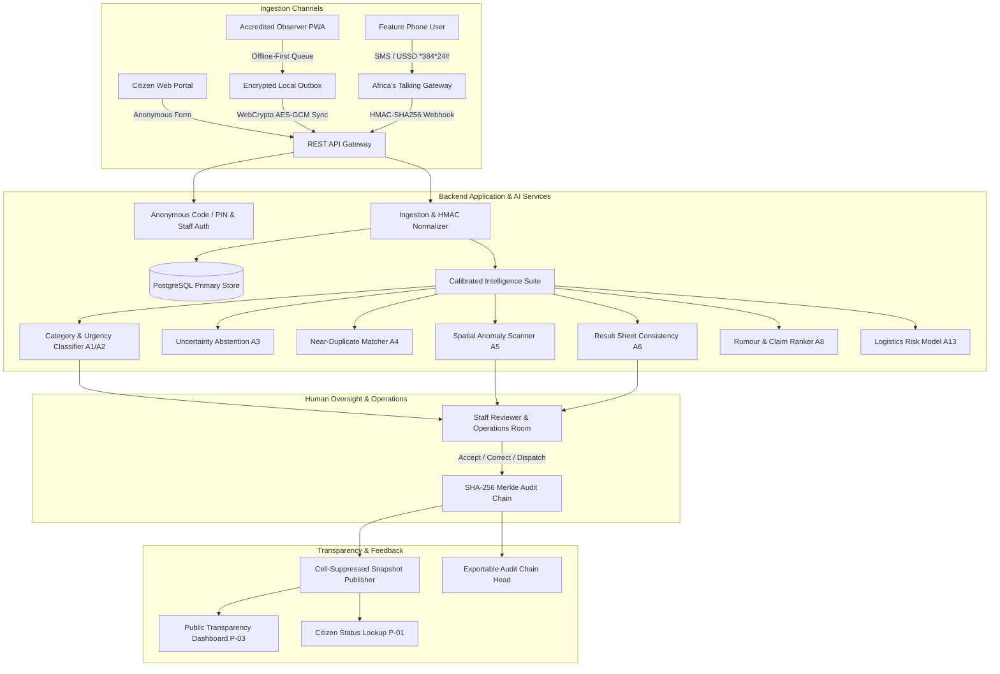

# Architecture and Technical Design: ElectraGuard AI

**Hackathon Challenge:** #AI4Elections Track 5 — Election Observation and Citizen Accountability  
**Team:** Cairn  
**Date:** 2026-11-24  
**Status:** Prototype

---

## 1. System Overview

ElectraGuard AI is a nonpartisan, offline-first election observation, incident verification, and civic accountability platform built specifically for low-connectivity environments in Nigeria.

### System Context Diagram


---

## 2. Core Components

| Component | Responsibility | Tech Stack | Owner |
|---|---|---|---|
| **Observer PWA (`app/(observer)`)** | Offline checklist, incident reporting, PIN management, encrypted outbox. | Next.js 16 App Router, React 19, CSS Modules, WebCrypto | Front-End Team |
| **Staff Console (`app/(staff)`)** | Queue triage, case review, redaction, operations room, rumour approval, audit export. | Next.js 16 App Router, React 19, CSS Modules | Front-End Team |
| **Public Portal (`app/(public)`)** | Citizen reporting, receipt lookup, public transparency dashboard with `< 5` cell suppression. | Next.js 16, React 19, Server Components | Front-End Team |
| **API Gateway & Core (`backend/`)** | REST API endpoints, organisation scoping, observer code authentication, case transitions. | Django 5, Django REST Framework, PostgreSQL | Backend Team |
| **Intelligence Engine (`backend/intelligence`)** | Triage (A1), urgency (A2), abstention (A3), duplicates (A4), clusters (A5), result checks (A6), rumour ranking (A8). | Python 3.12, scikit-learn, NumPy, SciPy | AI / ML Team |
| **Telecom Channels (`backend/phone_channels`)** | SMS and USSD callback webhooks, HMAC phone hashing, outbound receipt dispatch. | Africa's Talking API, Django Channels | Telephony Team |
| **Cryptographic Audit (`backend/reports`)** | Immutable SHA-256 tamper-evident hash chaining for all state transitions. | Python `hashlib`, PostgreSQL | Security Team |

---

## 3. Data Flow and Privacy Boundaries

```
[Observer/Citizen Input]
       │
       ▼ (Client: zero personal data collected; phone numbers hashed to HMAC-SHA256)
[WebAPI / Django Gateway]
       │
       ▼ (Encrypted in transit via TLS 1.3; authenticated via batch token / session)
[Database Storage]
  ├── Raw report narrative (sanitized of immediate regex PII)
  ├── Anonymous Reporter Hash (`HMAC-SHA256(phone, rotating_salt)`)
  └── Location: LGA / Ward / Polling Unit Code
       │
       ▼ (AI Inference: read-only feature extraction; generates suggestions only)
[Reviewer Interface (S-03)]
  ├── Interactive text redaction tool (masks names/plates)
  └── Human decision: Accept, Correct, or Reject
       │
       ▼ (Appended to SHA-256 Audit Chain Head)
[Public Transparency Engine (PUB-01, P-03)]
  └── Aggregation to LGA level; small-cell suppression (< 5 reports -> "< 5")
```

---

## 4. Models and Algorithmic Logic

1. **Category Triage (A1):** Calibrated multi-class model predicting 7 product categories (`access_barrier`, `equipment_failure`, `good_practice`, `intimidation_violence`, `lack_of_information`, `late_materials`, `queues_crowding`).
2. **Urgency Classification (A2):** Cost-sensitive probability scoring tuned on validation split (`threshold = 0.439`) combined with deterministic heuristic elevation rules for danger, violence, and local spikes.
3. **Uncertainty Abstention (A3):** When model confidence falls below `0.40`, the model explicitly abstains (`abstain = true`), routing the item to manual human triage without automated pre-selection.
4. **Duplicate Detection (A4):** TF-IDF n-gram and Levenshtein character similarity constrained within matching polling unit / ward boundaries and 2-hour temporal windows.
5. **Spatial Cluster Detection (A5):** Poisson-based temporal scan statistic over rolling 60-minute windows across contiguous wards.
6. **Result-Sheet Consistency (A6):** Five deterministic mathematical assertions:
   - $V_{accredited} \le V_{registered}$
   - $\sum V_{party} + V_{rejected} = V_{ballots\_cast}$
   - Flagging identical vote totals repeated across consecutive polling units.
   - Identifying Benford's law / round number anomalies ($V \pmod{50} = 0$).
   - Digit transposition checks ($\text{diff} \pmod 9 = 0$).
7. **Grounded Retrieval ("Ask ElectraGuard"):** Retrieval-Augmented Generation constrained strictly to pre-approved field guides, returning exact quoted text passages with source citations. If similarity is below threshold, it returns an honest abstention (*"I do not have approved guidance on this matter. Please contact your coordinator."*).

---

## 5. Human Oversight Points

| Touchpoint | System Proposal | Human Action Required | Fallback if Human Unavailable |
|---|---|---|---|
| **Incident Review (S-03)** | Suggested category & urgency level | Reviewer must click "Accept" or select "Correct" | Report remains marked "Received / In Review"; never auto-promoted. |
| **Rumour Desk (S-06)** | Suggested veracity score & public risk score | Dual authorization: two separate analysts must sign off | Debunk is held in draft; never published to public channels. |
| **Result-Sheet Flags (S-05)** | Arithmetic inconsistency warning | Auditor examines physical/scanned EC8A image | Warning displayed in dashboard; vote totals never altered. |
| **Public Transparency (PUB-01)** | Draft aggregated snapshot | Organization Admin approves cutoff & publication | No new snapshot published; previous snapshot remains active. |

---

## 6. Security & Privacy Architecture (STRIDE Threat Model)

| Threat Category | Target Component | Technical Mitigation | Residual Risk |
|---|---|---|---|
| **Spoofing** | Observer Reporting | Random alphanumeric batch codes + 6-digit bcrypt PINs; observer identity never stored. | Credential theft mitigated by PIN lockout after 5 attempts. |
| **Tampering** | Audit & Case Records | Merkle-style SHA-256 hash chaining (`AuditChainHead`); every transition is tamper-evident. | Database compromise cannot forge historical chain hashes. |
| **Repudiation** | Staff Review Actions | Cryptographic signing of review actions with actor UUID and timestamp in immutable audit log. | None. |
| **Information Disclosure** | Informant / Reporter Identity | Zero PII stored; phone numbers converted to HMAC-SHA256; public dashboard suppresses cells < 5. | Re-identification via side-channels prevented by LGA aggregation. |
| **Denial of Service** | Web & Telecom API | Gateway webhook rate limiting (10 req/sec per IP/phone); exponential backoff on client retry. | Distributed volumetric attacks mitigated by Cloudflare / reverse proxy. |
| **Elevation of Privilege** | Staff Workspace | Strict role-based access control (RBAC): Observer, Reviewer, Coordinator, Moderator, Org Admin. | Role boundary violations caught by unit tests and middleware. |

---

## 7. Deployment and Operations

- **Containerized Architecture:** Fully dockerized via `deploy/compose.yaml` (Django REST API, PostgreSQL 16 with PostGIS, Next.js Node runtime, Redis cache).
- **Target Cloud Environment:** Microsoft Azure (Azure App Service / AKS, Azure Database for PostgreSQL, Azure Blob Storage with customer-managed keys).
- **Low-Resource Local Execution:** Runs completely on standard commodity hardware (4-core CPU, 8 GB RAM) via local SQLite/Postgres test harness.
- **Offline Client Operation:** Service Worker caches app shell; WebCrypto AES-GCM local storage queues reports until connectivity resumes.

---

## 8. Scalability & Sustainability

- **Bandwidth Optimization:** Frontend CSS Modules, tree-shaken icons, SVG artwork (~12 KB gzip), total first-page payload under 300 KB.
- **Cost Drivers:** Minimized by avoiding expensive external commercial LLM API calls on polling day; all primary triage, urgency, and cluster models run locally on lightweight CPUs.
- **Long-Term Handover:** Clean modular Python/Next.js codebase released under open-source licensing for seamless handover to accredited Nigerian civil society observation coalitions.

---

## 9. Architectural Decision Records (ADR)

| Date | Decision | Alternatives Considered | Rationale |
|---|---|---|---|
| **2026-11-20** | Anonymous Code + PIN for Observers | Email + Password, Phone SMS OTP | Protects observers from physical search and retribution; zero personal data stored. |
| **2026-11-22** | Local Calibrated Classifiers vs Remote LLM | Cloud LLMs / proprietary external APIs | Zero external network dependency on polling day; deterministic; predictable latency; no PII transmission. |
| **2026-11-23** | Small-Cell Suppression Threshold (< 5) | K-Anonymity, Epsilon Differential Privacy | Simple, transparent, and provably prevents re-identification in rural polling units. |
| **2026-11-23** | Plain CSS Modules over Tailwind / UI Frameworks | Tailwind CSS, Material UI, Shadcn | Strictly guarantees zero bloat, predictable 44px tap targets, and bundle size < 300 KB. |
